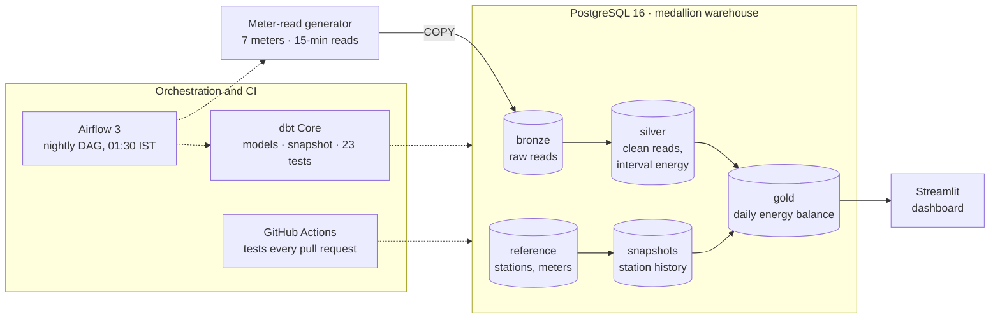
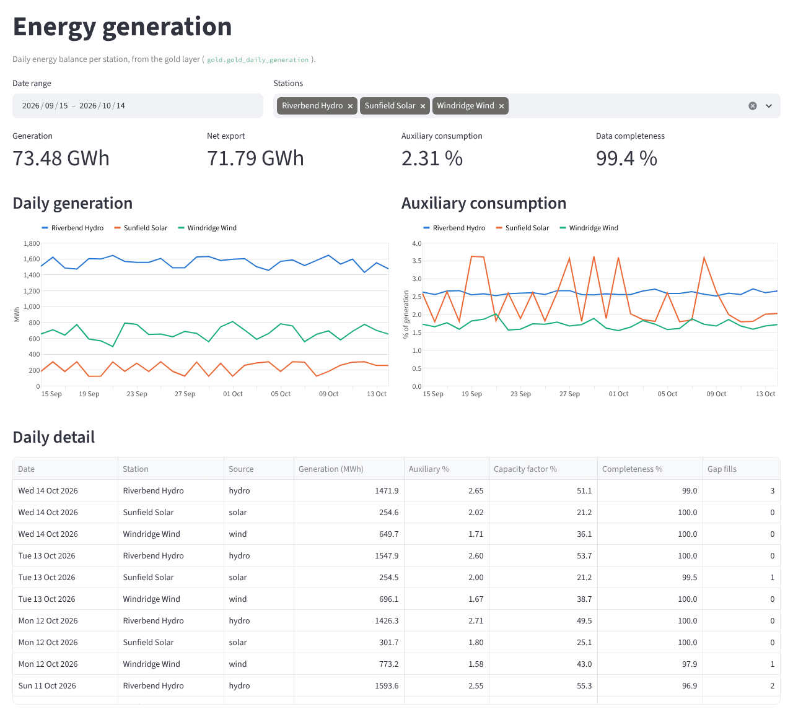
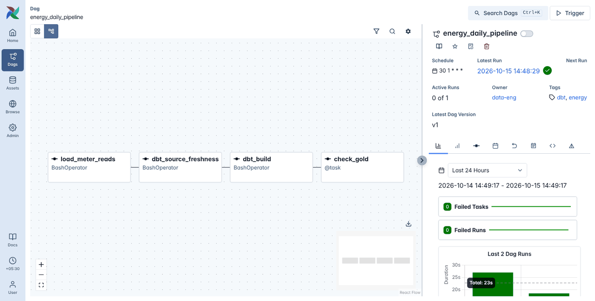
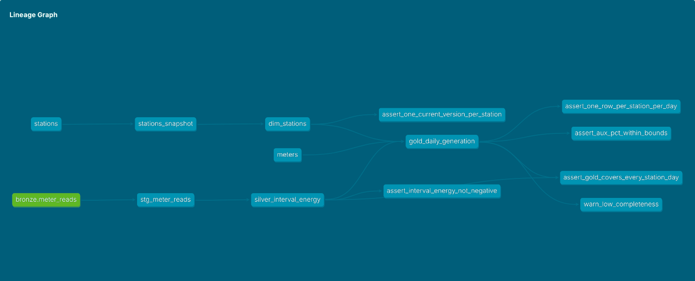

# Energy Data Platform

[](https://github.com/krishnamunjeti99/energy-data-platform/actions/workflows/ci.yml)


An end-to-end data platform for **15-minute energy-meter data** from three
generating stations (hydro, solar and wind). Raw meter reads land in a
PostgreSQL **medallion warehouse** (bronze → silver → gold), are transformed and
tested with **dbt** (incremental models, SCD Type 2 history, 23 data tests), and
feed an analytics **dashboard**. **Airflow** runs the pipeline every night, and
**GitHub Actions** tests every change end to end on a fresh database.

The domain comes from industrial power-monitoring systems: meters report
cumulative energy registers, communications drop out, and reads arrive twice.
The pipeline handles all of that explicitly instead of assuming clean data.

---

## Architecture



Solid arrows are data; dotted arrows are control. Every night Airflow runs
`load_meter_reads → dbt_source_freshness → dbt_build → check_gold`; dbt builds
silver, the station snapshot and gold, and runs the tests. Everything runs in
Docker Compose: `postgres`, `generator`, `dbt`, `dashboard` and `airflow`.

---

## Screenshots

**Dashboard:** daily generation, auxiliary consumption and data completeness per station, read straight from the gold layer.



**Airflow:** the nightly DAG (`load_meter_reads → dbt_source_freshness → dbt_build → check_gold`).



**dbt lineage:** bronze to gold, with the station snapshot and data tests.



---

## Tech stack

| Area | Tools |
|---|---|
| Storage | PostgreSQL 16 (medallion: bronze, silver, gold, reference, snapshots) |
| Ingestion | Python 3.12, psycopg 3 bulk `COPY` |
| Transformation | dbt Core 1.12: incremental models (`merge`), snapshot (SCD2), seeds, `persist_docs` |
| Data quality | 23 dbt tests (generic, singular, warn-level), source freshness |
| Orchestration | Apache Airflow 3.3 (standalone, LocalExecutor) |
| Analytics | Streamlit, Altair |
| CI | GitHub Actions: ruff, pytest, end-to-end pipeline on a fresh Postgres, image builds |
| Packaging | Docker Compose, non-root images, pinned dependencies |

---

## Highlights and design decisions

| Decision | Why |
|---|---|
| **Interval energy from cumulative registers** (`lag()` over each meter's reads) | Meters report running totals. A missing read loses no energy: the next read covers the gap, and the row is flagged `is_gap_fill` instead of being dropped or guessed. |
| **Bronze is raw and append-only** | Duplicates and gaps are kept as delivered; silver deduplicates (`row_number()`) so every fix is traceable back to the source. |
| **Incremental silver and gold** with look-back windows and `merge` | Each night processes only recent data. The look-back lets `lag()` see across the batch boundary and absorbs late reads. |
| **Incremental == full refresh, verified** | `scripts/verify_incremental.sh` builds incrementally, rebuilds from scratch and compares row by row. CI runs it on every PR; with the look-back set to 0 it fails, which proves the check works. |
| **SCD Type 2 station history** (dbt snapshot → `dim_stations`) | When a station's capacity changes, past days keep the capacity factor of the capacity in effect then. History is never rewritten. |
| **Ratios weighted by energy**, not averaged per day | `sum(aux) / sum(generation)` instead of `avg(aux_pct)`, so a low-output day doesn't count as much as a full one. |
| **Idempotent catch-up loader** + `catchup=False` in Airflow | Reruns never duplicate data, and a pipeline that was down for three days fills all three on its next run. |
| **dbt and the generator in their own virtualenv** inside the Airflow image | Their dependencies never clash with Airflow's. |
| **One measure per chart**, colour-blind-validated palette | No dual axes; each station keeps its colour when others are filtered out. |

---

## Data model

| Layer | Object | Grain | Notes |
|---|---|---|---|
| bronze | `meter_reads` | one row per read as received | duplicates and gaps included |
| silver | `stg_meter_reads` (view) | one row per meter per 15-min block | deduplicated |
| silver | `silver_interval_energy` (incremental) | one row per meter per interval | energy from register deltas, gap flags |
| reference | `stations`, `meters` (seeds) | master data | CSV in the repo |
| snapshots | `stations_snapshot` | one row per station version | dbt snapshot, `check` strategy |
| gold | `dim_stations` | one row per station version | `valid_from` / `valid_to` dates |
| gold | `gold_daily_generation` (incremental) | one row per station per day | generation, auxiliary %, capacity factor, completeness |

Model and column descriptions are written into Postgres as comments
(`persist_docs`), so they show up in any SQL client.

---

## Testing

| Level | What it checks | Where |
|---|---|---|
| Unit | generator: every block present, registers never decrease, anomalies injected, reproducible, solar dark at night | `tests/test_generator.py` |
| Data | keys unique and not null, relationships, registers never go backwards, one row per station-day, auxiliary % plausible, every silver day reaches gold, SCD versions don't overlap, completeness warning | `dbt/models/**.yml`, `dbt/tests/` |
| Freshness | bronze received data recently | `dbt source freshness` |
| End to end | fresh Postgres → generate 30 days → catch-up is a no-op → `dbt build` → dashboard renders | CI `pipeline` job |
| Incremental | incremental result identical to a full rebuild after new data and a capacity change | `scripts/verify_incremental.sh` |
| Orchestration | DAG imports cleanly; tasks in the right order; `catchup=False`; one active run | `tests/test_dag.py` |
| Packaging | every Docker image builds | CI `docker-build` job |

---

## Quickstart

Requirements: Docker with Compose, and about 4 GB of RAM for Docker if you run Airflow.

```bash
git clone https://github.com/krishnamunjeti99/energy-data-platform.git
cd energy-data-platform
cp .env.example .env              # change POSTGRES_PORT if 5432 is in use

docker compose up -d postgres
docker compose run --rm generator --days 30     # 30 days of meter reads into bronze
docker compose run --rm dbt build               # seeds, snapshot, models, tests
docker compose up -d dashboard airflow
```

| Service | URL |
|---|---|
| Dashboard | http://localhost:8501 |
| Airflow (unpause and trigger `energy_daily_pipeline`) | http://localhost:8090 |
| dbt docs: `docker compose run --rm dbt docs generate`, then `docker compose run --rm --service-ports dbt docs serve --host 0.0.0.0 --port 8080` | http://localhost:8080 |

Run the checks locally:

```bash
python3 -m venv .venv && source .venv/bin/activate
pip install -r requirements-dev.txt
ruff check . && pytest
```

---

## Project structure

```
.
├── generator/            meter-read simulator → bronze (Python, COPY)
├── dbt/
│   ├── models/silver/    deduplication, interval energy (incremental)
│   ├── models/gold/      dim_stations, daily energy balance (incremental)
│   ├── snapshots/        station history (SCD Type 2)
│   ├── seeds/            station and meter master data
│   └── tests/            singular data tests
├── airflow/dags/         nightly pipeline DAG
├── dashboard/            Streamlit app on the gold layer
├── scripts/              verify_incremental.sh
├── tests/                pytest: generator, DAG, dashboard
├── docs/                 build log and screenshots
├── .github/workflows/    CI
└── docker-compose.yml
```

---

## Roadmap

- **AWS deployment with Terraform:** raw reads in S3, the warehouse on RDS
  PostgreSQL or Redshift, infrastructure as code.
- Streaming ingestion for near-real-time reads.

---

## Build log

The project was built in small steps, each a pull request with CI.
[docs/build-log.md](docs/build-log.md) has every step with its commands and
reasoning.

The stations are fictional and all data is simulated.
